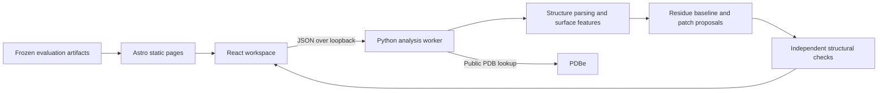

# Architecture

Astro builds informational routes to HTML. React hydrates the workspace, resource search, and benchmark controls. Three.js provides the homepage illustration; it does not perform scientific analysis. Fonts are self-hosted from the declared packages and public assets.

The worker lives in `prince-model`. It owns parsing, scoring, evidence review rules, and output serialization. The web repository does not vendor a second copy of that code. This separation avoids having two runtime implementations to update.

The default API origin is defined in `src/components/PrinceApp.tsx`. User connection settings select a local service. The frontend displays request failures and maintains an empty result state until an analysis succeeds.

The frozen validation downloads and `src/lib/protein.json` are presentation data. They are not fallbacks for a live result. The saved XGBoost ranker in the model repository is a separate inference path.

When changing response fields, update the TypeScript contract, model API implementation, and integration verification together. Keep the selected-hotspot check independent from suggested-site checks.
