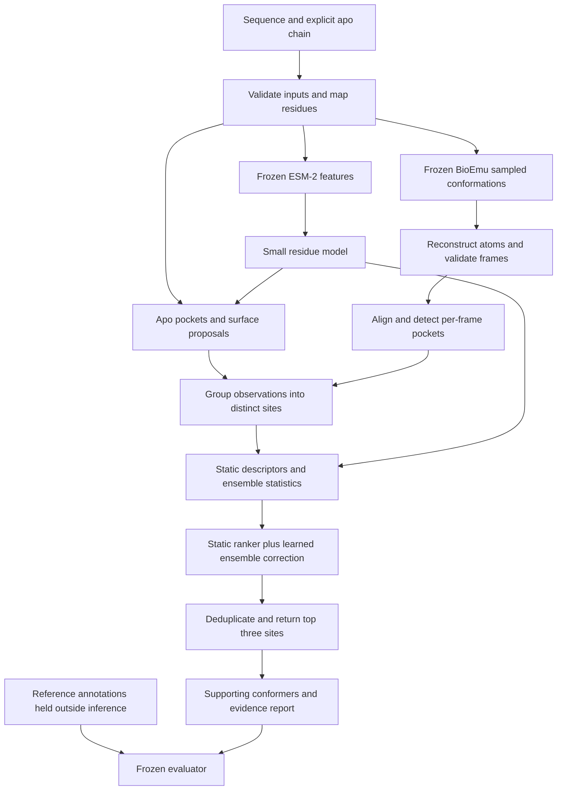

# Ember Pocket: master build specification

Date: 2026-09-24. Status: ready to guide implementation; not a frozen experiment, implemented training system, trained checkpoint, or compute-spending authorization.

This is the controlling implementation plan for Ember Pocket v0. It supersedes the default architecture choice in `senba-pocket-build-plan-2026-09-23.md` and `dynamics/senba-pocket-experiment-v0.json`: the first implementation is a frozen-embedding residue model plus small site rankers. The geometric graph network is a gated extension. Historical documents and code remain unchanged for provenance. The companion `dynamics/ember-pocket-v0-plan.json` is a planning manifest, not executable infrastructure.

The [benchmark research memo](ember-pocket-benchmark-protocol-2026-09-24.md) contains source comparisons and the rationale for CryptoBench and CryptoBank. No Ember performance result exists yet.

## 1. North star and first scientific contract

Long-term objective: predict which protein states matter for function, then predict which molecular or sequence interventions shift those states in a useful direction.

First product: given a sequence and an explicitly selected experimental apo chain, return at most three distinct cryptic-site hypotheses, mapped residue IDs, supporting conformations where available, quality flags and reproducible provenance.

First research question: does explicit conformational evidence improve recovery of annotated cryptic sites beyond sequence features, apo geometry and simple ensemble statistics, at a measured inference cost?

First scope: soluble, primarily folded monomers, provisionally 80–350 residues with valid sequence/structure mapping. The length range is an engineering starting point and must be finalized from metadata and profiling before test evaluation. Exclude targets whose biological interpretation requires an unsupported assembly, membrane environment or missing chemistry; record the exclusion reason. Never choose supported targets from their prediction scores.

This version does not predict trajectories, transition rates, binding affinity, physical state populations or intervention effects. It does not design protein binders. Pocket localization, open-pocket geometry, binding and functional modulation are separate validation steps.

The intended claim is conditional: on the named cohort, under the fixed input and output budget, Ember changes site recovery by X percentage points at Y dollars per target compared with Z. Best-in-world and best-ever claims are unsupported. Even a successful pocket benchmark does not establish general leadership in dynamics.

## 2. End-to-end system

BioEmu receives sequence, not the experimental apo coordinates. Its outputs are unordered conformations. ESM-2 embeddings used by Ember are separate from BioEmu's own preprocessing. Sidechain reconstruction, sampling, downloads and CPU preprocessing count toward total runtime and cloud cost.

Every stage consumes immutable, hashed inputs and emits a completion manifest. A missing output, failed mapping or parser error is a typed failure, not an empty successful result. Inference cannot read the held-out reference annotation directory.

## 3. Data acquisition and partitioning

### Main data

Use the original [CryptoBench repository](https://github.com/skrhakv/CryptoBench/) and its linked [OSF release](https://osf.io/pz4a9/). Acquire structures, annotations, official splits and tutorial/schema information. Pin and hash the downloaded release. Actual download integrity, counts and exclusions remain unresolved; do not assume a paper's retained test count equals our cohort size.

Preserve the official test assignment. Use provided development folds where appropriate or construct grouped validation from official training records only. Keep related proteins and all their apo/holo pairs, mutants and conformations together. Audit train/test similarity; if the official split has overlaps under our stricter rule, remove affected training relatives and report the amendment. Maintain official-protocol reproduction separately when preprocessing differs.

For the cross-source audit, start with sequence identity >=40% and alignment coverage >=80% of the shorter sequence, then inspect shared domains/structural similarity where available. This is a documented relatedness heuristic, not proof of family independence. Save similarity edges and cluster assignments so the result can be audited.

### External data

Reserve a metadata-selected experimental-apo cohort from [CryptoBank](https://github.com/Gervasiolab/CryptoBank), using its [paper](https://pmc.ncbi.nlm.nih.gov/articles/PMC13267282/) and [archive](https://zenodo.org/records/19099155). Remove relatives of Ember train/development proteins. Record overlap with CryptoBench test proteins and with comparator training sets. The original high-identity grouping is not sufficient for remote-family claims. Confirm release accessibility, automated annotation policy, permitted use and exact cohort before committing to this evaluation.

Do not train on CryptoBank v0 external targets. If we later use them to improve Ember, they cease to be an untouched external test for that version. Do not add PLINDER pretraining to the first month by default; it adds annotation and overlap work before its benefit is established.

### Manifest contracts

| Artifact | Required fields |
| --- | --- |
| Target manifest | target ID, source/release/hash, sequence/hash, assembly/model/chain, apo hash, protein/group ID, partition, eligibility and reason |
| Residue mapping | canonical index, author chain/residue/insertion code, observed residue, atom mask, mapping confidence, missingness |
| Reference manifest | exact holo structure/chain and ligand instance, annotated site IDs/residue sets, label mask, mapping and reference validity |
| Model provenance | code commit, checkpoint hash, settings, declared training data, known/unknown overlap |
| Cost/job manifest | stage, input hashes, runtime, requested/valid frames, billed-resource estimates, provider receipt, status |

Reference annotations for training are accessible to label construction. Development labels are available only to development evaluation. Test labels remain unavailable to inference and training. Normalizers, feature selection and thresholds are fitted on training/development data only.

Public foundation models may have encountered related structures or sequences during pretraining. Keep that exposure separate from head-training leakage. An unseen example for our head is not automatically unseen by the complete system.

## 4. Input preparation, conformations and candidates

### Step 1: normalize one explicit target

Read mmCIF/PDB with explicit model and chain selection. Never choose the longest peptide. Preserve missing segments and insertion codes. Verify sequence alignment and store an observed-residue mask. Apply deterministic alternate-location and residue-normalization rules. Reject ambiguous target or ligand identity.

Labels use the benchmark's supplied residue definitions wherever possible. Any reconstructed ligand contacts must identify the exact ligand by structure/model/chain/residue/entity and use a documented threshold. A three-letter ligand name alone is not an identifier.

### Step 2: compute frozen sequence embeddings

Initial Ember encoder: `esm2_t30_150M_UR50D`, last-layer per-residue features, excluding special tokens. Expected width is 640; assert actual tensor shape in the adapter. Preserve sequence position for missing apo residues, while geometric operations use masks. Cache `[L, 640]` tensors and encoder/tokenizer hashes. Frozen means no backbone gradients.

Official baseline reproduction must use the authors' actual encoder and checkpoint. A different backbone comparison measures the full method; use the matched 150M encoder for Ember component attribution.

### Step 3: propose apo sites

Run pinned fpocket on the prepared apo structure. Save actual pocket-lining residue sets, cavity centers, detector features and raw output. Confirm filename numbering and feature semantics using real output from the pinned binary.

Add sequence-derived surface proposals as a controlled development variant after the fpocket-only path works. The implementation uses a fixed surface/residue clustering adapter with thresholds selected on development data. Save the complete adapter configuration. Do not create proposals from reference ligand coordinates or select the adapter on test results.

### Step 4: generate conformations

Use a frozen, explicitly pinned [BioEmu](https://github.com/microsoft/bioemu) checkpoint. Proposed initial checkpoint is `bioemu-v1.1` for a well-defined starting experiment; verify its current interface, training exposure and artifacts before launch. Do not allow a moving package default to change the generator mid-run.

Use 16 requested conformations for smoke profiling and consider 32 for the fixed experiment only if cost permits. Store requested, generated, filtered and reconstructed counts separately. Do not silently retry until every protein reaches an arbitrary valid-frame quota. Retries must be capped and included in cost. Fixed requested counts and variable valid counts are reported together.

Read topology and trajectories explicitly. Verify actual reconstructed output format and frame count against the installed version; do not assume an expected PDB filename contains every frame. Sidechain reconstruction can create artificial cavities, so record both backbone and all-atom quality checks.

### Step 5: physical and mapping checks

Check finite coordinates, atom/residue identity, chain continuity, gross clashes and missingness. Use the generator's documented filtering plus named all-atom checks; record exact versions and numerical thresholds before freeze. Thresholds are not established by this plan and must be validated on development examples. Filter outcomes are features and failure statistics, not a guarantee of realistic thermodynamics.

Align each accepted conformation into the apo coordinate frame using explicitly mapped shared backbone atoms. Store transforms. Use local mapped alignment separately for conformer-geometry evaluation. Global alignment can be misleading for moving domains, so inspect its effect on grouping during development.

### Step 6: detect and group sites

Detect pockets on each accepted all-atom frame. Convert lining residues into canonical IDs before grouping. Start with deterministic complete-link grouping using residue-set Jaccard >=0.35; investigate a spatial consistency criterion on development data. Avoid unbounded centroid single-link chains that merge neighboring sites. These are proposal grouping rules, distinct from the evaluation matching rule.

Represent a grouped site by a residue-set medoid observation, not the unrestricted union of every lining residue. Keep all observations and per-frame features. Count each site at most once per frame. Remove final near-duplicate predictions with a prespecified overlap rule, initially Jaccard >=0.5. Freeze thresholds, tie ordering and candidate cap after development.

Start with at most 64 grouped candidates per target, capped by a deterministic non-reference score. Measure the cap's effect on candidate coverage before selecting it. This cap is provisional. Never remove a valid site solely because it appears in fewer than 20% of frames.

## 5. Exact initial trainable components

### R0: residue model

`LayerNorm(640) -> Linear(640,256) -> GELU -> Dropout(0.1) -> Linear(256,128) -> GELU -> Dropout(0.1) -> Linear(128,1)`.

Output is an annotation-recovery logit for each residue. It is not a calibrated probability that the residue binds any molecule. Train a logistic linear probe on the same features as a control. Report the actual parameter count rather than advertising an arbitrary million-parameter target.

Use masked binary cross-entropy, average within protein and then across proteins, and derive any positive class weighting from training data. Start with AdamW, learning rate 1e-3, weight decay 1e-4, gradient norm cap 1, maximum 50 epochs and patience 5 on development macro residue average precision. Initial effective batch is eight proteins using accumulation if needed. Stop earlier at the stage budget cap. Exact seeds and settings are recorded.

### S0: static site score

Build a small vector of apo-only features for each proposed site: pooled R0 logits, site size, residue chemistry, exposure, local packing/contact descriptors and available apo detector features. Explicit missingness flags distinguish absent features from zero-valued features. Fit normalization/imputation on training only.

Start with an L2-regularized linear pairwise ranker. Compare an MLP with widths 64 then 32, GELU and dropout 0.1. Use the same site candidates for this architecture comparison.

For stacking R0 outputs into a downstream ranker, use three grouped cross-fitting folds within training data: each training protein receives R0 predictions from a model that did not train on its group. Train the final R0 on the allowed full training partition for development/test inference. Normal cross-fitting does not use development/test labels. Profile the extra cost; if it does not fit, keep stages as independent baselines rather than silently substituting optimistic in-sample predictions.

### E0: ensemble correction

For each site, compute per-frame cavity volume, exposure, enclosure, local contact changes relative to apo, physical-quality indicators and mapped site support. Aggregate mean, maximum and dispersion over valid observations, with counts and masks. Detection support is not physical occupancy. Pooling uses unordered frames.

Score: `s(site) = S0(static features) + delta(ensemble features)`.

Start `delta` with a regularized linear ranker; the nonlinear candidate is a 64/32 MLP with a zero-initialized output layer so initial predictions reproduce S0. Freeze S0 during this correction experiment. If no valid ensemble exists, emit a recorded static fallback rather than fabricating ensemble evidence. Evaluate the fallback as part of the whole system and report its frequency.

Ranking supervision uses `q(site) = max Jaccard(predicted residues, annotated site residues)`. Initially construct pairs with one candidate at q>=0.25 and another at q<0.10; ignore ambiguous pairs between those cutoffs. Optimize `log(1 + exp(-(s_positive - s_nonmatch)))`, averaged per target, with a fixed pair cap. These are known-annotation nonmatches, not verified biological negatives. Targets lacking valid pairs contribute no pairwise loss but remain in evaluation and residue training.

Use AdamW at 1e-3 for new MLP heads, weight decay 1e-4, gradient clip 1 and maximum 50 epochs with development top-three recall for selection. All training features, candidate-generation settings and pairing rules are versioned. For fixed-pool training, freeze R0 proposals before ranker optimization; do not change candidates underneath cached labels.

### G0: optional learned geometric encoder

Only after E0 improves on the static control and time/budget remain, test the previously proposed shared four-block GVP encoder, scalar width 128, vector width 16 and 16 nearest neighbors. Compare mean/max set pooling before attention. Keep matched embeddings and cached candidates. No parameter-count target is a success criterion.

G0 is not required for the first release and must not consume the evaluation reserve. Conformer-geometry regression, generator fine-tuning, ligand conditioning, large multitask pretraining and active sampling are later projects with their own evidence requirements.

### Tuning limit

The fixed R0/linear/static controls are planned baselines. Allow at most three development-selected E0 configurations, initially linear correction, small-MLP correction and the selected correction without detection-frequency features. Do not launch a large sweep. G0 requires an explicit scope/budget revision. Repeat the selected trainable model with up to three seeds only if the training allocation permits; otherwise disclose single-seed evidence.

## 6. Representative conformer and report

For each returned site, select a physically accepted supporting observation using a fixed rule based on the model's feature contribution and geometry quality, with deterministic ties. Begin with detector score among valid site observations if no per-frame learned score exists. Do not describe a site-level ranker as a trained conformer selector.

Store ranked site residue IDs, uncalibrated score, whether evidence is apo/ensemble/fallback, representative structure path, frame counts, feature summaries, known input limitations, checkpoint hashes and runtime/cost. A user should be able to inspect the structure and original residue numbering.

Best-of-N agreement with the bound reference is an evaluator-only sampling diagnostic. The model-selected conformer's agreement is the deployable selection metric. Always distinguish them. Neither a good cavity score nor a short relaxation certifies docking readiness or binding.

## 7. Evaluation and advancement rules

Use two evaluations: each method's end-to-end native pipeline and matched-candidate ranking ablations. A static scorer applied to ensemble-generated candidates is a ranking diagnostic; it is not an apo-only end-to-end method because the proposals already contain ensemble information.

Mandatory starting controls: fpocket, P2Rank, matched-encoder R0/static model, and BioEmu with ordinary pocket scoring. Attempt CryptoBench pLM-NN, Seq2Pocket, PocketMiner/AE-PocketMiner and relevant Lacuna configurations as reproducible strong comparisons. Verify code, weights, inputs and training overlap before claiming a head-to-head result. The full suite may exceed $200; publish omissions and never substitute an incomparable literature number for an unrun method.

Primary custom metric: macro per-protein annotated-site recall@3 with one-to-one matching of predicted/reference mapped-residue sets at Jaccard >=0.25. Use maximum-cardinality bipartite matching, deterministic ties, and no more than three distinct predictions. Freeze grouping and candidate-size rules to prevent trivially oversized predictions. Report the threshold as part of the claim.

Secondary metrics: recall@1/@5, macro residue AP, candidate coverage at the fixed cap, coverage-to-shortlist conversion, predicted site sizes, successful output rate, selected-conformer local geometry, cold/warm runtime and actual dollars/target. Preserve each author's official protocol in separate tables. Center-to-center and center-to-any-ligand-atom distances are different metrics.

Eligible job failures are misses for the primary site metric. Successful static fallback is scored normally and flagged. Reference-invalid records must be resolved before freeze. No silent shrinking of the denominator. Report undefined residue AP cases and their prespecified handling.

Compute paired differences and 95% intervals with family-cluster bootstrap, provisionally 10,000 CPU resamples. Conformers and training seeds are not independent protein replicates. Show individual seeds separately and disclose model-selection uncertainty. A favorable point estimate with a wide interval is inconclusive.

An aspirational development target is +10 percentage points in recall@3 over the strongest reproduced comparator at a stated cost ceiling. It is neither a forecast nor a post-hoc definition of success. Freeze an actual cost ceiling after profiling. A useful accuracy/cost tradeoff may justify continued work even without that target, but the claim must reflect the results.

If E0 does not improve development performance, inspect candidate coverage, label alignment and physical validity. If they are correct, retain the stronger simpler method and revise the dynamics hypothesis. Do not make the model larger merely to spend the allocation.

After freeze, evaluate the public test once per release. Test-driven changes require a new version and fresh untouched evidence. CryptoBank external validation is conditional on successful acquisition, independent eligibility and available evaluation resources.

## 8. Required implementation and tests

The following paths are proposed files to implement, not commands or modules that already work.

| Work item | Proposed location | Acceptance condition |
| --- | --- | --- |
| Typed manifests and validation | `dynamics/ember/schema.py` | Reject duplicate IDs, invalid partitions, missing provenance and contradictory statuses. |
| Release ingestion and split audit | `dynamics/ember/data.py`, `splits.py` | Reproducible counts/hashes and no prohibited group overlap. |
| Residue/chain/reference mapping | `dynamics/ember/mapping.py` | Correct insertion codes, missing loops, multiple ligands and ambiguous chains. |
| Frozen feature cache | `dynamics/ember/embeddings.py` | One feature per sequence residue; special tokens removed; cache invalidates on encoder/input change. |
| Sampler and reconstruction adapter | `dynamics/ember/sampling.py` | Actual frames accounted for; one smoke target passes the installed real interface. |
| Geometry validation/alignment | `dynamics/ember/geometry.py` | Rigid transforms preserve invariant results; all spatial comparisons share declared frames. |
| Pocket adapter and grouping | `dynamics/ember/candidates.py` | Real fpocket output parsed; distinct sites preserved; invalid files cause errors. |
| Feature extraction | `dynamics/ember/features.py` | Train-only normalization; masks and rare valid observations retained. |
| R0, S0 and E0 training | `dynamics/ember/models.py`, `train.py` | Tiny-data overfit sanity check, real development run, checkpoint resume parity. |
| Comparator adapters | `dynamics/ember/baselines/` | Same input contract, explicit method output type and failures. |
| Reference-isolated inference | `dynamics/ember/predict.py` | Runs with no test reference access; emits validated records. |
| Frozen evaluation/report | `dynamics/ember/evaluate.py`, `report.py` | Correct top-k one-to-one matching, failure accounting, paired results and uncertainty. |
| Job/cache/budget manager | `dynamics/ember/jobs.py`, `budget.py` | Idempotent jobs, bounded retries, reservations, checkpoint upload and shutdown verification. |

Existing code to repair or isolate before reuse: `datasets.py` merges same-name ligands; `ensemble.py` chooses the longest peptide and assumes a reconstruction output contract; `pockets.py` returns origin coordinates for missing files and mislabels sphere count as residue count; `aggregate.py` lacks explicit reference alignment and drops missing references; `benchmark.py` awards hits from an unlimited candidate list; `cryptic.py` removes rare sites by a hard persistence cutoff. Verify real fpocket numbering rather than trusting the synthetic fixture.

Meaningful scientific tests: exact chain/ligand selection; residue remapping; known rigid rotation/translation; permutation of conformer order; duplicate-frame behavior; no silent loss of trajectory frames; no bridging of two nearby sites; fixed top-k limits; one reference cannot be matched twice; every failed eligible target remains in the denominator; label isolation; cache invalidation; resume from checkpoint agrees with uninterrupted training on a deterministic tiny run within specified tolerance.

Synthetic tests validate contracts, not biological accuracy. Real baseline reproduction and a small real-data end-to-end smoke run are separate release requirements.

## 9. Compute, budget and portable sessions

| Allocation | USD | Purpose |
| --- | ---: | --- |
| Preflight and smoke profiling | 25 | Verify dependencies, real adapters and end-to-end costs. |
| Cached features and conformations | 65 | Embeddings, sampling, reconstruction and CPU pocket processing. |
| Training/development | 50 | Fixed controls and tightly limited correction experiments. |
| Frozen evaluation | 35 | Remaining baseline/test inference and result production. |
| Storage, failed jobs and late charges | 25 | Contingency reserved from the start. |
| Total | 200 | All attributable cloud resource charges, not GPU time alone. |

Evaluation feature costs may be incurred in the cache stage; charge them once and label the partition. Before bulk work, estimate `sum(runtime_per_stage * billed_rate) + storage + transfer + startup`, using short/medium/long development proteins and a conservative allowance for failures. Do not extrapolate one fast target to the entire benchmark. Never infer complete runtime from sampler-only throughput.

If the projected experiment does not fit, first reduce optional models and sweeps. Then reduce conformer count using development evidence. If a smaller cohort is necessary, choose it deterministically from eligible metadata/family IDs before predictions; name it as a subset and preserve all its failures. If neither a meaningful training set nor a defensible evaluation fits, end the stage with a feasibility report rather than claiming a full benchmark.

Each job reserves a conservative maximum cost before launch. New jobs cannot consume evaluation/contingency reserves. Use provider-specific timeouts and billing controls where available, and reconcile receipts; a local ledger is not a hard cloud billing cap. Do not assume exhausted credits automatically terminate compute safely.

For portable sessions, save model, optimizer, scheduler, AMP scaler if used, epoch/step, random states, data-sampler position, config, split hash and code version. Upload atomically, verify checksum/loadability, then terminate compute. Save `latest` and `best-development` separately. Resume only with compatible state and verified manifests. Cached feature jobs are independently restartable by protein.

Seven $30 balances nominally total $210; this plan retains a $200 cap and does not assume balances can be pooled or used interchangeably. Provider, credit terms, ownership, current balances and cross-session storage remain unresolved. No account creation, credit workaround or paid execution is part of this plan.

## 10. Thirty-day work sequence

| Time | Deliverables | Required gate |
| --- | --- | --- |
| Days 1–3 | Original release acquisition, schema, eligibility and overlap inventory | Sources accessible, records map correctly, data roles explicit. |
| Days 4–7 | Mapping/parser/evaluator repairs and cheap baseline adapters | Scientific contract tests pass; real development smoke succeeds. |
| Days 8–11 | Frozen features, linear residue probe and R0 | Held-out development metrics and actual feature costs recorded. |
| Days 12–14 | Static candidate pipeline, cross-fitted training features, S0 | Strong static floor and honest candidate coverage established. |
| Days 15–18 | Profiled BioEmu cache, all-atom validation, grouping | Frame accounting and projected cost acceptable. |
| Days 19–21 | E0 and its fixed ablations | Decide whether conformational evidence helps. |
| Days 22–24 | Comparator completion within budget, reproducibility audit | Exact cohort, configs, checkpoint and scoring frozen. |
| Days 25–27 | Frozen test and conditional external test | No test-guided tuning; failures retained. |
| Days 28–30 | Report, failure gallery and partner evaluation specification | Claim limited to actual evidence and supported scope. |

Dates are sequencing targets, not guarantees. Data acquisition and reconstruction problems can consume the month. Preserve the gate order rather than skipping validation to meet a calendar date. One owner can implement this sequence; parallel agents are not assumed.

## 11. What could make this competitive

| Hypothesis | Why it could help | Required evidence |
| --- | --- | --- |
| Sequence prior plus conformational correction | Combines a strong cheap signal with structural information | E0 improves over matched-encoder S0 on unseen groups. |
| Rare valid openings are retained | Hard frequency cutoffs may discard relevant candidates | Coverage and shortlist improvement without exploding invalid proposals. |
| Local geometry/contact features | May separate useful openings from generic flexibility | Feature ablations and failure inspection support the contribution. |
| Learned ranking of fixed candidates | May improve shortlist quality without retraining a generator | Same-candidate comparison beats simple detector/linear scoring. |
| Cached computation and small heads | May improve practical accuracy per dollar | Measured end-to-end cost curve, including preprocessing and failures. |

These are falsifiable proposals, not established unique inventions. [Seq2Pocket](https://github.com/skrhakv/seq2pocket) already converts residue predictions to spatial sites; [Lacuna](https://github.com/mooreneural/lacuna) already combines ensembles, detection, grouping and fitted ranking. A defensible contribution must be established against these relevant alternatives.

## 12. What happens after the first result

A positive result leads to a narrowly scoped blinded partner evaluation with pre-agreed targets, comparator and experimental decision. Lab work needs a separate quote and budget. Obtain appropriate rights to use resulting measurements before treating them as training assets.

A stronger long-term system would use paired measurements of ligand/mutation effects on states and function. Equilibrium populations require population-sensitive evidence; kinetics require time-dependent evidence. Pocket labels alone cannot supervise those claims. A protein-binder design business requires an additional design/production/assay workflow whose benefit from Ember must be demonstrated.

A negative or inconclusive result still yields a baseline, dataset audit and diagnosis. Fix a verified bottleneck before escalating compute. Do not convert development improvements, structural pictures, partner interest or earlier SENBA results into Ember validation.

Final release package: immutable manifests, pinned environments, trained checkpoint if successful, raw predictions, per-target metrics and failures, paired uncertainty, cost receipts, ablations, representative structures, limitations and a reproducible report. Investors and partners should be able to trace every headline to these artifacts.

## 13. Readiness checklist

- Ready to implement: yes, this specification identifies modules, dependencies and acceptance criteria.
- Ready for a full paid run: no; resolve releases/checkpoints, provider authorization, cost profile, numerical preprocessing thresholds and frozen manifests first.
- Ready to claim improved performance: no; train and complete the declared evaluation.
- Ready to claim physical dynamics, binding or functional improvement: no; those require additional task-specific evidence.

The next authorized engineering task is the schema/mapping/evaluator foundation on local fixtures and development data. Training and cloud launch are subsequent milestones, not completed work.
