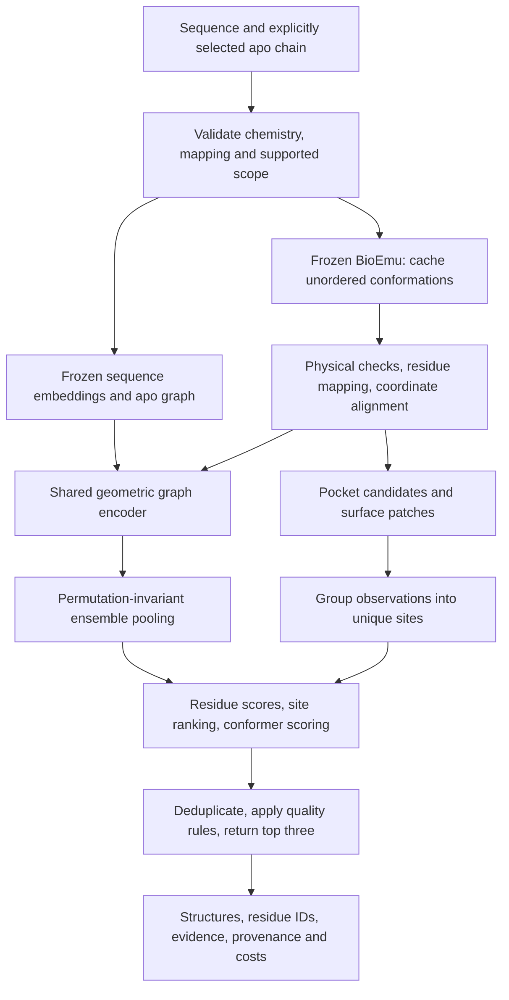

# SENBA-Pocket: full model and pipeline build specification

23 September 2026 · Design v0.1 · Research budget: USD 200 maximum proposed cloud spend

This document specifies the proposed build and evaluation pipeline. Implementation, training, protocol freeze and compute authorization follow in later stages. The accompanying [experiment configuration](senba-pocket-experiment-v0.json) records proposed settings; provider controls enforce cloud billing limits separately. Dataset/checkpoint versions, sample counts and runtime estimates must be resolved before the experiment is frozen.

## 1. Decision and scope

Build an ensemble-conditioned pocket-localization and conformation-ranking model. The first scientific objective is to improve a fixed top-three shortlist of cryptic binding sites on previously unseen eligible protein families, relative to strong public baselines, at a measured inference cost.

The first product accepts a sequence and a selected apo chain, produces at most three unique sites, maps each site to original residue identifiers, and returns physically screened representative conformers and a reproducible evidence report.

Version 0 is restricted to soluble, primarily folded monomers, initially 80–350 residues with reliable sequence-to-structure mapping. Length and eligibility limits must be applied before seeing prediction results. Report excluded targets and limit claims to the supported domain. An eligibility-restricted subset of a benchmark is not the full benchmark.

SENBA-Pocket is a proposed pocket-site model using conformational information. Physical trajectories, binding kinetics, affinity, equilibrium populations and intervention-driven changes require separate models and validation. The long-term extension is predicting how mutations and ligands change accessible functional states; that extension needs different data and validation.

The falsifiable hypothesis is: local structural evidence across an explicit ensemble improves site prioritization and representative-conformer selection beyond sequence features, apo geometry, and simple ensemble statistics.

## 2. Competitive correction

The model is untrained. Evaluate its performance on a named task using matched inputs, targets, output budget and metrics.

| Comparator | Established capability | Proposed advantage to test | Evidence required |
| --- | --- | --- | --- |
| fpocket / P2Rank | Fast geometric/chemical pocket localization | Recover hidden sites and rank them appropriately | Matched-target top-k recovery, physical validity, cost |
| CryptoBench pLM-NN / UniPocket | Cryptic-site signals in frozen sequence embeddings | Add useful structural evidence beyond sequence | Same embedding-backbone ablation and official baseline reproduction |
| PocketMiner / AE-PocketMiner | Learned cryptic-site prediction from a single structure; AE adds attention | Explicit ensembles resolve ambiguities in one structure | Same targets, model versions, residue-level and site-level evaluation |
| BioEmu plus ordinary pocket scoring | Generate alternative conformations and inspect cavities | Learn which sampled sites/conformers deserve the shortlist | Identical cached ensembles and candidate pools |
| Lacuna | Ensemble generation, site detection, clustering and fitted ranking | Better ranking or a better quality/cost tradeoff on the supported slice | Direct comparison with its strongest relevant available configuration |
| Target X | Enhanced simulation and ligandability assessment | Potential lower cost or useful complementary cases | Future licensed, matched evaluation; currently unestablished |

Sources: [PocketMiner](https://www.nature.com/articles/s41467-023-36699-3), [AE-PocketMiner](https://github.com/bowman-lab/ae-pocketminer), [CryptoBench](https://github.com/skrhakv/CryptoBench/), [UniPocket](https://pubmed.ncbi.nlm.nih.gov/42605276/), [BioEmu](https://github.com/microsoft/bioemu), [Lacuna](https://github.com/mooreneural/lacuna), [Target X](https://www.eyesopen.com/targetx).

Two important updates to the earlier strategy: CryptoBench provides over 1,000 structures with train/test resources; use it as the central cryptic-site resource rather than trying to train a large network on the small original PocketMiner panel. Lacuna already implements explicit ensembles and learned site ranking. This combination alone is not novelty. Its reported configuration scores use different cohorts and conformer counts, so published headline percentages are not interchangeable with our new evaluation.

## 3. Inference pipeline

### 3.1 Normalize and validate

Require explicit model, assembly and chain identity. Do not silently select the longest peptide. Preserve author chain, residue number, insertion code, canonical index, sequence and mapping confidence. Define handling of alternate locations, missing segments, modified residues, cofactors and ligands. Fail unsupported chemistry explicitly; do not silently convert a multimeric/cofactor-dependent problem to a monomeric one.

Use the submitted sequence as the reference and verify all mapped residues. Missing residues receive masks rather than shifted indices. Record input hashes and intended conditions. Do not present predictions as temperature- or pH-conditioned when the generator does not support that conditioning.

### 3.2 Frozen representations and conformations

Use BioEmu as an unchanged generator in the first experiment. It receives sequence, not the experimental apo coordinates. The apo structure supplies the ranker’s reference and structural input; BioEmu conditioning uses the sequence.

Cache sequence embeddings with the exact checkpoint name/hash. For reproducing sequence baselines, use their actual published encoder and preprocessing. For our compact run, a frozen ESM-2 150M encoder is the starting engineering choice; a result against a larger-encoder baseline compares full methods; architecture attribution requires a matched encoder. Include a matched-encoder baseline.

Generate 16 conformers first in the smoke test. The first fixed scientific run targets 32 per protein if profiling permits. Reserve 64 as a later development-only sample-size experiment. Do not select sample counts from test performance. Cache raw output, physical-filter outcomes and seeds; requested and valid counts are different quantities.

Backbone-only outputs require reconstruction before atom-based cavity analysis. Read every trajectory frame against its topology; a topology PDB is not automatically a multi-model ensemble. Record sidechain-reconstruction versions and failures. Do not silently treat one reference frame as many samples.

Use shared-residue alignment into the apo reference frame before spatial clustering. Score local pocket geometry under a separately defined local alignment; retain global-alignment results as a sensitivity check where domain motion matters. Cross-frame contact features based on invariant distances do not need global alignment. Filter broken geometry and implausible backbone continuity using prespecified checks; preserve rejection counts.

### 3.3 Candidate sites

Run fpocket on valid all-atom conformers and the apo structure. Preserve the actual residue set, cavity points, detector score and conformer ID, not only a centroid. Verify output numbering against a real pinned-version fixture.

Add apo surface patches proposed by a frozen sequence/site model as the next candidate-source ablation. This can propose sites that have little geometric concavity. Proposal thresholds and counts are fixed using training/development data. Never place proposals using reference ligand positions during inference.

Group candidates using mapped residue overlap plus local spatial agreement. Avoid unrestricted single-linkage centroid chains that merge distinct neighboring pockets. Require a bounded group diameter or complete-link constraint, and save observation-to-site mappings. Count a site at most once per frame. Detection frequency measures support across sampled conformers; physical occupancy and lifetime require separate measurements.

Version 0 must retain rare but valid candidate openings. The current hard 20% persistence filter is unsuitable as a universal gate because it discards rare cryptic sites. Compare filtering rules on development data and lock the rule before test evaluation.

Candidate pooling may increase coverage while hurting ranking by adding competitors. Measure both. Keep a fixed candidate cap decided on development data and quantify any coverage loss from the cap.

### 3.4 Model architecture

Start with four shared GVP message-passing blocks. Initial scalar width 128, vector width 16, 16 nearest-neighbor edges per residue, with distance radial-basis features and backbone orientation features. These are starting hyperparameters. Measure the actual parameter count and peak memory; target 2–5 million trainable parameters rather than expanding to reach that count.

Input tensors for one target:

- Frozen sequence features: `[L, D]`, identical across its conformers.
- Coordinates and masks: `[K, L, 3]` for C-alpha plus backbone/sidechain-derived features as available.
- Per-conformer graph features: residue identity, geometry, detector association, solvent exposure and contact-change descriptors.
- Apo graph and mapped candidate memberships: a residue set for every candidate/site observation.

The graph encoder produces `[K, L, H]` scalar features plus equivariant vector channels. Pool vector information into invariant scalar features before scalar scoring. For each corresponding residue, attention pooling across K gives a representation that is invariant to frame ordering. Include mean/max pooling as a cheaper comparator. Mask absent residues/invalid frames.

Pool residue representations over each site, then combine them with site-level descriptors: pocket size/enclosure, changes from apo, exposure changes, contact changes, structural validity, and sample support. Normalize training features on training data only. Avoid raw chain length or pocket size becoming shortcuts by auditing size-stratified results.

Prediction heads:

1. Residue membership head: scores evidence that a residue belongs to an annotated cryptic site.
2. Site head: ranks deduplicated sites for this target.
3. Optional conformer head: scores local compatibility with experimentally observed bound-pocket geometry. Implement only after residue/site ranking passes its development gate.

Keep an apo/sequence base score and learn an ensemble correction. Begin with a simple additive residual and ensemble-feature dropout. A learned gate, uncertainty network or mixture of experts is deferred until there is evidence it improves validation. This prevents an overcomplicated first experiment.

Representative-conformer selection chooses among the proposed ensemble. Equilibrium state and druggability require separate assessment; proposal coverage bounds the available choices.

## 4. Data and labels

### 4.1 Data roles

| Source | Role | Limit |
| --- | --- | --- |
| CryptoBench | Cryptic-site training/development and designated test evaluation | Preserve official split; audit related proteins and benchmark reuse |
| PLINDER apo/holo pairs | Optional general pocket/geometry pretraining | Structural displacement pairs; crypticity and equilibrium behavior require separate labels |
| PocketMiner original panel | Historical external diagnostic | Audit overlap with CryptoBench and pretrained generators before calling it independent |
| BioEmu benchmark suite | Optional conformational coverage/distribution diagnostics | Separate site-ranking and functional evaluations required |

[CryptoBench](https://github.com/skrhakv/CryptoBench/) supplies data and splitting resources through its linked OSF release. [PLINDER](https://github.com/plinder-org/plinder) provides linked apo/holo systems and similarity-based split tooling. Check exact release licenses and provenance before using either. PLINDER currently flags problems with its affinity annotations; those annotations are not required for this plan.

Create the split manifest before expensive features. Preserve the designated test fold, assign internal development folds from training groups, and purge cross-source relatives. Keep every conformer, apo/holo pair, mutant and duplicate of a protein family in the same partition under a documented similarity rule. Record sequence identity and structural similarity where available. Audit known source-model training exposure separately; do not call the entire system unseen merely because our new head has not seen it.

Build a deterministic, eligibility-based subset only if full evaluation exceeds budget. Select it by metadata/group hashing before reading target labels or results. Publish exact subset IDs and why it is a subset. Never shrink the denominator after failed prediction jobs.

### 4.2 Annotation policy

Use curated cryptic-site labels where provided. For general ligand contacts, identify the exact ligand instance by chain/residue/entity rather than a three-letter ligand name alone. Explicitly handle biological cofactors and crystallization additives. Map heavy-atom contacts (initial training definition: 5 Å) through verified sequence alignments to apo residue IDs. Thresholds are recorded and fixed; use the original benchmark definitions for a separately reported official-protocol reproduction.

Do not label all unobserved sites as experimentally nonbinding. For the structural-recovery task they are nonmatches to the known annotation; call them that. Use benchmark-supplied masks/labels consistently, conservative treatment of unannotated regions, and separate curated negative controls. Annotation-recovery calibration targets the supplied labels; biological binding calibration requires binding data.

Construct geometry labels by comparing generated candidate conformers with bound reference pocket coordinates after prespecified residue mapping/alignment. Reference coordinates and ligand contacts are evaluator/training-label assets only. They cannot be used to select inference frames or proposals. Mask the geometry loss where a candidate has no sufficient mapped reference site; do not train an undefined target.

## 5. Training curriculum

### Stage A: establish the cheap floor

Train a regularized linear/logistic ranker on cached site descriptors. Add a small boosted-tree ranker if data volume supports it. Include a frozen-embedding MLP residue baseline. These are low-cost controls and possible final models if the graph network does not beat them.

### Stage B: static geometric network

Train the shared graph encoder on apo inputs. Use CryptoBench training labels first; PLINDER pretraining is optional and must earn its extra preparation cost. If pretraining is added, purge test-related families before training. Batch by protein, cap sampled residues, and weight proteins equally so long proteins and abundant conformers do not dominate.

### Stage C: ensemble correction

Initialize from Stage B and add mean/max ensemble pooling, then one attention-pooling candidate. Use the same cached conformers and candidates for the attribution comparisons. Never cache trainable encoder outputs across weight updates; cache raw graphs and frozen features instead.

Initial objective:

`L = L_residue + 0.5 * L_site_rank + 0.2 * L_geometry`

The geometry term is disabled until its head and labels pass the audit. Residue loss uses masked, class-weighted binary cross-entropy for the declared annotation task. Site ranking uses within-target pairwise logistic loss between higher- and lower-overlap candidates. Sample ambiguous nonmatches conservatively, cap pairs per protein and disclose incomplete-label limitations. Geometry uses robust regression on local structural error only for supervised candidates.

Match candidate overlap to every annotated site without revealing that match to inference. Pairwise labels can use graded overlap, with supervision targeting annotation recovery; lower-ranked candidates retain unknown biological status. Include residue loss when a target's proposal pool misses its site; do not drop difficult targets because ranking pairs cannot be constructed.

Start with AdamW, learning rate 1e-3 for newly initialized heads and 1e-4 for the pretrained trainable graph blocks, weight decay 1e-4, dropout 0.1, gradient clipping 1.0. Use gradient accumulation and small per-target batches. Profile mixed precision for numerical stability. Maximum 50 epochs with development-only early stopping; wall-time and dollar caps override epochs.

Run at most three development configurations in the $200 experiment. Select one using the prespecified development metric, then repeat the selected configuration with additional seeds if the training budget permits. Record a one-seed result as such. Do not consume the final-evaluation reserve chasing a nicer development score.

### Stage D: freeze and evaluate

Freeze weights, all preprocessing, candidate clustering, sample counts, ranking rules and thresholds. Store hashes and export the checkpoint. The test evaluator runs once per frozen release. A bug fix after inspection requires an explicit amendment; do not call repeated test-guided iteration an untouched test.

## 6. Evaluation contract

Two complementary experiments are mandatory: end-to-end comparisons with each method's own proposals, and ranking-only comparisons with identical candidate pools. End-to-end gains can come from sampling/proposals; ranking-only gains isolate the new scorer. Report total inference cost, not just the final network's milliseconds.

Primary proposed metric: macro per-protein annotated-site recall at three unique predictions. For each target, match predicted sites to reference sites one-to-one, then divide matched reference sites by annotated reference sites. Average targets equally. Site match uses mapped-residue Jaccard >= 0.25. Report the threshold's sensitivity on development data, then lock it. This custom metric is separate from any author's published metric.

Secondary metrics: top-1/top-5 recovery; residue AUPRC; candidate coverage before ranking; conversion of covered sites into top-three hits; representative-conformer local RMSD; valid-output rate; runtime and actual cost. Report the centroid-based and official published matching criteria separately where needed for reproducibility. Coordinates must share a documented frame before spatial comparisons.

Failure policy: every prediction failure on an eligible, reference-valid target is a miss in the primary analysis. Invalid benchmark references are resolved before freezing; exclusions afterward require a protocol amendment and sensitivity analysis. Return failed, unsupported and no-candidate statuses distinctly.

Statistics: paired protein/family-cluster bootstrap intervals for differences on the exact same cohort; report per-target outcomes and raw counts. Do not bootstrap conformers as independent proteins. Use 10,000 resamples for the final report if CPU time permits. A small directional gain with a wide interval has uncertain magnitude and direction; report the point estimate and interval together.

Engineering invariance tests: arbitrary rigid rotations/translations, consistent residue-ID remapping, frame permutation, absent-residue masks, frame duplication sensitivity, chain/ligand ambiguity rejection, no silent frame loss, and no train/test feature contamination. Any centroid-based legacy comparator must fail validation until its coordinate transformation is explicit.

Essential scientific ablations, in order:

1. Sequence + apo versus the same model with ensembles.
2. Simple descriptors/ranker versus geometric network.
3. Mean/max pooling versus attention pooling.
4. Same candidate set scored by the old rule versus our learned head.
5. Additional sampling versus additional model capacity, at matched total cost.

An auxiliary geometry head, new proposal source, adaptive sampling and multiple-model uncertainty are second-round experiments. Do not turn the $200 experiment into an uncontrolled architecture sweep.

## 7. Existing code issues to fix first

Static inspection of `dynamics/` found these blockers; remote execution was not performed:

| File | Observed behavior | Required correction |
| --- | --- | --- |
| `datasets.py` | CSV conversion loses apo/holo chain and split information; ligand centroid merges all instances sharing a residue name | Preserve chain, insertion code, ligand instance, mapping and split metadata |
| `ensemble.py` | Picks longest reconstructed peptide; expects reconstructed PDB to contain all frames | Explicit chain/sequence mapping; read topology + trajectory; verify frame counts |
| `run_target.py` | Clusters raw generated centroids and compares them to apo pockets without an explicit alignment stage | Align using mapped residues; record transform and quality |
| `aggregate.py` | Compares raw holo centroids with generated predictions; silently skips missing references | Reference-frame mapping; frozen denominator and explicit failure policy |
| `benchmark.py` | Counts any prediction as a hit with no fixed shortlist | Ranked top-k metrics, deduplication, coverage and paired cohorts |
| `pockets.py` | Missing pocket-atom files yield `(0,0,0)`; alpha-sphere count stored as residue count | Reject/mark missing data; count actual unique residues; real-version output fixture |
| `cluster.py` | Centroid-only single-link grouping can bridge distinct sites | Residue-aware bounded clustering and stored membership |
| `cryptic.py` | Applies 20% persistence as a hard gate | Development-tested rare-site retention and clear sample-support semantics |

These issues can invalidate an otherwise attractive result. Existing unit tests cover those legacy behaviors; the scientific comparison requires corrected contracts. Fix their scientific contracts before training and add regression tests that would catch the old failures.

## 8. Implementation map and artifact contracts

Proposed package: `dynamics/senba_pocket/`. These modules/commands are a build specification, not existing callable software.

| Module | Responsibility | Verification |
| --- | --- | --- |
| `manifest.py` | Normalize CryptoBench/PLINDER metadata, IDs, releases and splits | Exact identifiers, no cross-partition groups, hashes |
| `structures.py` | Chain extraction, sequence mapping, ligand selection and transforms | Rotation/translation and ambiguous-input tests |
| `cache.py` | Content-addressed frozen embeddings, ensembles, raw graphs | Key includes input, checkpoint, preprocessing and seed |
| `sampling.py` | Pinned generator/reconstruction, frame accounting | Requested/generated/valid/extracted reconciliation |
| `proposals.py` | Pocket/surface observations and unique-site grouping | No label-dependent input and no bridge merging |
| `features.py` | Graphs, apo deltas, site descriptors and masks | Finite values and train-only normalization |
| `model.py` | Shared GVP encoder, set pooling and heads | Symmetry, masking and permutation tests |
| `train.py` | Bounded training, seeds and dev-only selection | Learning sanity test and holdout-access audit |
| `predict.py` | Label-free inference and deterministic top-three output | Input/output schema and failure tests |
| `evaluate.py` | One-to-one matches, coverage, paired uncertainty | Hand-calculated ranking/multi-site fixtures |
| `report.py` | Tables, curves, errors, model card and reproducibility pack | All denominators reconcile |
| `budget.py` | Reservations, job limits, reconciliation and provider stop | Failed reservations block launches; shutdown verified |

Manifest record: target ID; dataset/release; sequence and structure hashes; chain/model/assembly; residue mapping; split and family group; eligibility/reason; labels path in a separate namespace; and source-model exposure status.

Prediction record: target/checkpoint/cache hashes; inference status; ranked unique site IDs; original residue IDs; score type; selected conformer ID; geometry/validity descriptors; generated/valid sample counts; runtime; billed/estimated cost distinction; and limitations. Never expose test-reference geometry as part of inference output.

Budget receipt: job ID/provider, reserved maximum, hourly rates for all resources, elapsed time limit, storage reservation, actual reported charge, reconciliation timestamp and stopped-state evidence. A local ledger tracks reservations; provider controls enforce spending limits. Bound each job's runtime, keep concurrency low, reserve late-billing margin and shut down persistent resources.

Data directory separation: `inputs/` and frozen `features/` are available to inference; `labels/train` and `labels/dev` are available to training; `labels/test` is loaded only by the final evaluator. Keep output provenance under a unique experiment ID. Do not overwrite raw artifacts or previous result files.

## 9. Budget and execution gates

The $200 funds a bounded first computational experiment with a profiled comparison suite; wet-lab validation requires a separate stage. It excludes human labor. All cloud resources, preprocessing, storage, failed jobs and applicable charges must fit inside it. Credits reduce cash spend only when verified usable.

| Stage | Ceiling | Release condition |
| --- | ---: | --- |
| Pipeline validation and baseline pilot | $25 | Correct mappings, real frame extraction, valid candidate coordinates, measured rates |
| Cached features and ensembles | $65 | Frozen split/eligibility; projected workload fits with evaluation reserve intact |
| Small-model training and limited selection | $50 | Useful state coverage and a plausible gap in baseline ranking |
| Frozen evaluation and essential ablations | $35 | Frozen winner and identical declared test cohort |
| Storage/failures/late-billing reserve | $25 | Reconciliation only; not an automatic extra sweep |
| Total | $200 | No unreserved jobs |

For orientation only, Runpod's checked pricing lists A100-80GB at $1.59/hour and RTX 4090 at $0.74/hour; availability and ancillary charges vary. Choose hardware using measured throughput and compatibility, not headline hourly price alone. [Pricing](https://www.runpod.io/pricing).

The first measurement is three representative development proteins: small, medium and near the length limit. Measure cold setup, embeddings, sample generation, reconstruction, cavity analysis, training memory and storage. Project both the training and final evaluation costs. Choose a deterministic smaller panel or cheaper feature path if needed; do not run out of money before evaluation.

If the $25 stage finds poor sampling coverage, stop the learned-ranker experiment and investigate sampling. If cheap ranking already converts most available coverage, a more complex scorer has little headroom. If published checkpoints cannot be reproduced within budget, report which comparisons remain unavailable.

## 10. Milestones, improvements and evidence standard

Indicative schedule for focused engineering, subject to the validation gates:

| Phase | Work | Deliverable |
| --- | --- | --- |
| Days 1–3 | Dataset and competitor audit; fix coordinate/ID contracts | Split manifest, source register, baseline protocol |
| Days 4–7 | Real three-system smoke test and baseline profiling | Correct outputs and measured end-to-end cost |
| Week 2 | Cache bounded development data; train cheap/static models | First honest reference report |
| Week 3 | Train ensemble correction and essential ablations | Selected frozen checkpoint |
| Week 4 | Untouched evaluation, failure analysis, packaging | Checkpoint, model card, reproducible benchmark and demo |

The final demonstration must run on an eligible input not used for tuning. Show the input, three predictions, valid representative conformers, elapsed time, total cost and whether reference evidence is available. Demo selection follows the frozen protocol; a visually striking cherry-picked success is not the benchmark.

Further improvements must follow observed failure modes:

| Observed failure | Next experiment | When to do it |
| --- | --- | --- |
| Correct site never proposed | Surface proposals, alternative sampler, focused valid sampling | Before spending on a larger ranker |
| Correct site proposed but buried | Better within-target ranking and conservative hard nonmatches | Core $200 experiment |
| Similar sites duplicated | Residue-aware clustering/diversity selection | Before scoring final metrics |
| Model relies on protein size or dataset identity | Family splits, balanced weighting, shortcut ablations | Before interpreting a gain |
| Same scores across conformations | Add geometry supervision or abandon ineffective ensemble branch | After inspecting feature and gradient behavior |
| Unphysical open conformers score highly | Stronger validity features and restrained relaxation checks | After a real artifact pattern is observed |
| Ensemble results unstable with K | Prefix-preserving K sensitivity and cost-aware sampling | Second round; no test-driven K selection |
| Generalization fails on a target family | Acquire better labeled examples and define supported scope | After honest external evaluation |
| Static model is equally good | Ship the cheaper model or change the task | Report the static-versus-ensemble comparison |

To reach a strong public-benchmark standard, require reproducible improvements over the strongest accessible relevant baselines, meaningful uncertainty, independent target families, multiple training seeds where feasible, no hidden prediction failures and a documented cost/quality tradeoff. A tentative target is a 5–10 percentage-point absolute top-three gain, but whether that is statistically and practically meaningful depends on the cohort and uncertainty; the observed effect remains to be measured.

To reach an industry-use standard, additionally require an external blinded/prospective test, experimental evidence that selected sites or conformers are useful, repeatable turnaround and support for relevant target chemistry. Private-system comparisons require blinded external evaluations, and downstream hit-rate improvement requires experimental measurements.

The release pack should contain code/environment lock, dataset and split manifests, model weights and hashes, baseline commands/versions, all eligible target outcomes, cost receipts, plots, model card and known failures. The model's scientific claim must name the exact task and comparison. Report pocket-site recovery under that protocol; kinetics and binding probabilities require their own validation data.

## 11. What is already done versus what remains

Completed for this planning pass: workspace implementation audit; current comparator/dataset research; model/pipeline specification; proposed experiment settings and budget allocation. No new training, GPU provisioning, bulk dataset download, or scientific benchmark was run.

Existing assets to reuse: Papercrane's workflow/provenance UI and the legacy dynamics modules after their contracts are corrected. Prior SENBA work supplies research experience; the pocket model awaits training and evaluation. Its evaluated 450 K motion checkpoint is an optional future ablation; v0 uses the frozen generators specified above.

Next executable deliverable: corrected chain/frame/alignment pipeline plus reproducible cheap baselines on the three-system development smoke panel. The benchmark and experiment configuration become frozen only after the data identities, software versions, actual costs and test policy are resolved.
